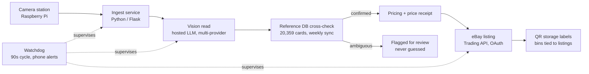

# card-pipeline

Production computer-vision pipeline that takes physical inventory from scan to live
marketplace listing — built and operated by one person.

## Architecture

## How it works

- A camera station photographs each physical trading card; a Python web service ingests the frame.
- A hosted vision model reads the card (name, HP, set number) behind a multi-provider
  abstraction (Google Gemini primary, swappable fallbacks via one env var).
- Every read is cross-checked against a 20,359-card local reference database (weekly
  auto-sync); ambiguous reads are flagged, never guessed.
- Live market data prices the card, and a deterministic "price receipt" records how each
  number was derived so it can be peer-reviewed.
- The card is listed on eBay through its Trading API (OAuth, photo upload, listing
  lifecycle); QR-coded storage labels tie physical bins to live listings and orders.
- A watchdog supervises all services on a 90-second cycle, auto-restarts failures, and
  pushes phone alerts; the system has run in production since February 2026 with
  1,000+ cards scanned and real orders processed end-to-end.

## Design decisions

- **Multi-provider vision behind one env var** — swapping Gemini for a fallback provider
  is configuration, not a code change. No single-vendor dependency.
- **Local reference database instead of per-scan API calls** — card identity data is
  static, so it is mirrored locally (weekly sync). Scanning works offline and never
  blocks on a third-party outage.
- **Flag, never guess** — when a vision read is ambiguous against the reference DB, the
  card is queued for human review instead of silently picking a candidate.
- **Price receipts** — every price is emitted as a deterministic receipt object (inputs,
  method, range, confidence), so the number can be audited after the fact.

## Tech stack

Python · Flask · hosted vision LLM APIs (Google Gemini + fallback providers) ·
eBay Trading / Sell / OAuth APIs · SQLite · Linux VPS deploy (systemd, nginx, TLS) ·
PowerShell + Task Scheduler ops · Raspberry Pi camera station

## Status

Sanitized public overview of a private production system that runs daily.
Most implementation stays private — but `watchdog/watchdog.ps1` is the real
production supervision pattern (transition-only alerting, per-service relaunch
with cold-start bind waits, phone alerts), sanitized to a generic config. For
more real code, see the companion repo
[fleet](https://github.com/KennySolis/fleet): the full dispatcher that
schedules work across my machines. Implementation walkthrough available on
request.
